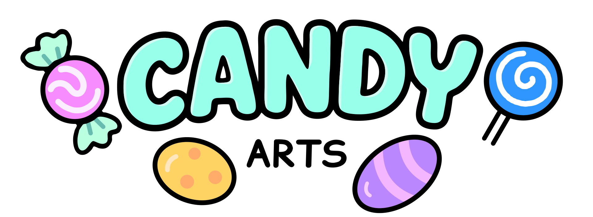

Welcome to Candy Arts, the creator of the powerful Candy Dialogue Engine! This readme will be updated with news about our assets. Please watch the repository to stay updated.

**Official links for your convenience:**

[Official website](www.candy-arts.com) | [Discord](https://discord.gg/CZ9RZxzmNf) | [Discussions](https://github.com/Candy-Arts/Candy-Arts/discussions) | [Youtube](https://www.youtube.com/@CandyArtsStudio/playlists)  | [Godot Asset Store](https://store.godotengine.org/publisher/candy-arts/) | [Gumroad](https://candyarts.gumroad.com/)

-----

We're launching a [Discord](https://discord.gg/CZ9RZxzmNf) server! Drop by if you need help with our assets, want to share feedback or to report bugs.
